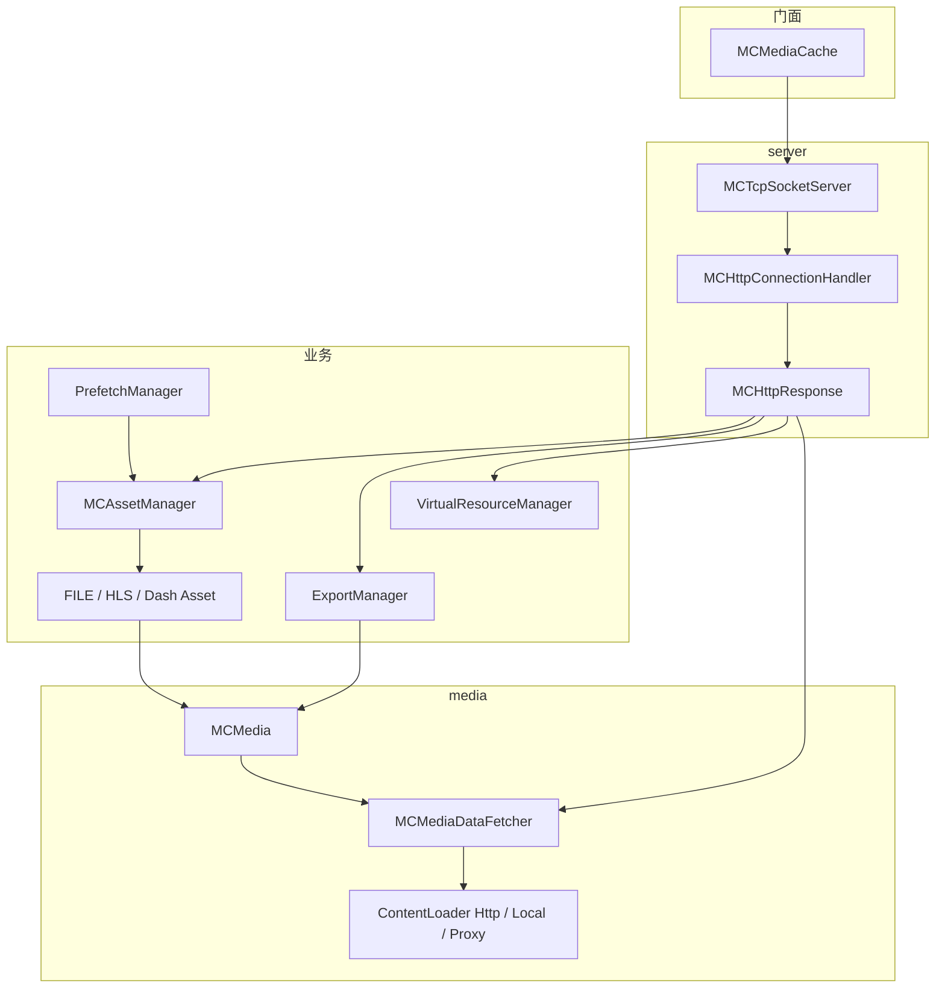
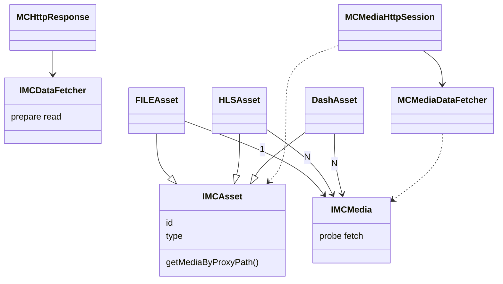

# MediaCache 代码架构

本文描述 `mediacache/src/main/ets/src` 的目录结构与模块关系，便于阅读与二次开发。

## 总体分层

代码采用**本地 HTTP 代理 + 领域对象分层取数**的结构：

| 层 | 目录 | 职责 |
|----|------|------|
| 门面 | `MCMediaCache.ets` | 对外 API、`prepare` 串起各子系统 |
| 传输 | `server/` | TCP 监听、HTTP 解析、响应流式写回 |
| 业务 | `asset/`、`prefetcher/`、`exporter/`、`virtual/` | 资源类型、预取、导出、虚拟源 |
| 数据 | `media/` | 单文件级缓存、Range、落盘、组包 |
| 契约/基础设施 | `defines/`、`utils/` | 接口、常量、下载、日志、代理 URL |



## 源码目录树

`src/` 下按职责划分的目录（核心文件，非完整文件列表）：

```text
src/
├── MCMediaCache.ets              # 对外门面
├── server/                       # 本地 HTTP 服务
│   ├── MCTcpSocketServer.ets
│   ├── MCHttpConnectionHandler.ets
│   ├── MCHttpResponse.ets
│   └── MCHttpRequest.ets
├── session/
│   └── MCMediaHttpSession.ets    # 播放 HTTP 会话（Asset → Media）
├── asset/                        # 资产（一次点播 / 一个播放列表树）
│   ├── MCAssetManager.ets
│   ├── MCAssetProxyUtils.ets
│   ├── MCAssetCapabilityRegistry.ets
│   ├── cachemgr/MCAssetCacheManager.ets
│   ├── cachestate/               # pin、访问日志（LRU）
│   ├── filebased/FILEAsset.ets
│   ├── hls/                      # HLSAsset、解析、代理改写
│   └── dash/                     # DashAsset、MPD 解析、代理改写
├── media/                        # 单个可 HTTP 请求的文件
│   ├── MCMedia.ets
│   ├── MCMediaDataFetcher.ets
│   ├── MCMediaContent*.ets
│   └── *ContentLoader.ets        # Http / Local / Proxy
├── prefetcher/                   # 预缓存（不经 TCP）
├── exporter/                     # 导出与 mc_dir_proxy 本地播
├── virtual/                      # 虚拟资源 mc_virtual_proxy
├── defines/                      # IMC* 接口与配置类型
└── utils/                        # 下载、URL、IO、日志、MCConfigs
```

## 模块说明

### `MCMediaCache.ets`（门面）

- 持有 `MCTcpSocketServer` 与 `MCHttpConnectionHandler`。
- `prepare`：启动 TCP、初始化 `MCAssetCacheManager`、`MCVirtualResourceManager` 等。
- 能力分发：`proxy` → `MCAssetProxyUtils`；`prefetch` → `MCAssetPrefetchManager`；`exportToDirectory` → `MCAssetExportManager`；全局钩子写入 `MCConfigs`。

### `server/` — 迷你 HTTP 服务

| 文件 | 作用 |
|------|------|
| `MCTcpSocketServer` | `127.0.0.1` 动态端口监听 |
| `MCHttpRequest` | 从 TCP 字节流解析 HTTP 请求 |
| `MCHttpConnectionHandler` | 每连接一个 handler；串行发送 header/body；支持 Range |
| `MCHttpResponse` | 按 `requestTarget` 选择 DataFetcher |

HTTP 路由前缀（`MCConsts`）：

| 路径前缀 | 含义 | 数据来源 |
|----------|------|----------|
| `/mc_proxy` | 远程 URL 边播边缓存 | `MCAssetManager` → `MCMediaHttpSession` |
| `/mc_based_proxy` | DASH 相对路径（先转为标准 proxy path） | 同上 |
| `/mc_dir_proxy` | 已导出目录离线播放 | `MCAssetExportManager` → `MCLocal*Asset` |
| `/mc_virtual_proxy` | 虚拟资源 | `MCVirtualResourceManager` |

### `asset/` — Asset 层

- **`MCAssetManager`**：`getAssetByProxyPath` 解析代理路径 → 按 `MCAssetType` 懒创建 `FILEAsset` / `HLSAsset` / `DashAsset`，内存中单例 per `assetId`；磁盘目录由 `MCAssetDirectoryManager` 管理。
- **`MCAssetProxyUtils`**：原始 URL → `assetType`、`assetId`、完整 `proxyUrl`；DASH 的 `based_proxy` 路径转换。
- **`session/MCMediaHttpSession`**：播放会话 `IMCDataFetcher` → `getMediaByProxyPath` → `MCMediaDataFetcher`。
- **`cachemgr/MCAssetCacheManager`**：个数、时长、总大小、磁盘预警、pin、删除缓存。
- **`cachestate/`**：`MCAssetStateRepository`（pinned）、`MCAssetAccessLogRepository`（清理依据）。

### `media/` — Media 层

- **`MCMedia`**（`IMCMedia`）：分片落盘（`MCMediaContentProvider` / `MCMediaContentNodeList`）、`probe` / `fetch` 支持 Range；缓存命中用 `MCMediaLocalContentLoader`，缺失用 `MCMediaHttpContentLoader`（`MCDownload`）。
- Playlist 类媒体可配置 **`proxyHandler`**，落盘后改写 m3u8/MPD 中的 URL 为代理地址（HLS/DASH）。
- **`MCMediaDataFetcher`**：HTTP 请求 → `media.fetch()` → 多个 `MCMediaContentLoader` 供给 `MCHttpResponse.read()`。

### `prefetcher/` 与 `exporter/`

- **Prefetch**：`generateAssetProxyPath` → `getAssetByProxyPath` → `FILEAssetPrefetcher` / `HLSAssetPrefetcher` / `DashAssetPrefetcher`，直接拉数据，不经 TCP。
- **Export**：从网络资产补齐并写入用户目录；`proxyDir` 使用 `MCLocalFILEAsset` / `MCLocalHLSAsset` 与 `/mc_dir_proxy`。

### `virtual/`

`MCVirtualResourceManager`：通过 `setVirtualResource` 注册数据源，不参与 `MCAssetCacheManager` 的磁盘资产目录体系。

### `defines/` 与 `utils/`

- **`defines/`**：`IMCAsset`、`IMCMedia`、`IMCDataFetcher`、HTTP Range/Headers、HLS/DASH 选型回调类型等契约。
- **`utils/`**：`MCDownload`、`MCProxyURLUtils`、`MCFileIOUtils`、`MCMediaIdGenerator`、`MCConfigs`、`MCLogger`、`MCAbortController`、`MCReadwriteReference` 等。

## 领域模型

- **Asset**：一次点播对应的逻辑资源（一个 mp4，或一棵 HLS/DASH 树）。
- **Media**：树中某一个具体 URL 对应的文件（mp4、ts、m3u8、分片等）。

`MCMediaKind`：`FILE`（普通文件）、`PLAYLIST`（主清单及需改写代理的 playlist）。



## 播放请求主链路

```text
播放器 GET http://127.0.0.1:{port}/mc_proxy/...
    ↓
MCTcpSocketServer → MCHttpConnectionHandler → MCHttpResponse.prepare()
    ↓
[可选] /mc_based_proxy → convertToProxyPath
    ↓
MCAssetManager.getAssetByProxyPath → FILEAsset | HLSAsset | DashAsset
    ↓
MCMediaHttpSession → getMediaByProxyPath → MCMediaDataFetcher
    ↓
MCMedia.fetch(Range) → LocalLoader + HttpLoader（落盘，可走 encryption handler）
    ↓
MCHttpResponse 组 200/206 → ConnectionHandler 流式 send
```

播放器只使用 HTTP；缓存与回源细节封装在 `MCMedia` 内。HLS/DASH 的子资源请求仍走 `/mc_proxy`，依赖 playlist 改写。

## 设计不变式（重构后）

1. 代理路径必须先解析 **Asset**，再 **Media**；字节只经 `IMCMedia` 与 ContentLoader 读写。
2. 播放请求使用 **`MCMediaHttpSession`**（`session/`）作为唯一 HTTP 会话 Fetcher。
3. 预取/导出经 **`MCAssetCapabilityRegistry`** 分发，能力矩阵以 `defines/MCAssetCapabilities` 为准（DASH：可播可预取，不可导出/本地目录播）。
4. 预取/导出持有 Asset 引用使用 **`MCRequestScope.withAsset`**。
5. 淘汰经 **`MCCachePolicy.canEvict`**：`readwriteCount > 0` 或 pin 的 Asset 本轮不删盘。

## 初始化顺序（概念）

`MCMediaCache.prepare` 大致包括：

1. 启动 `MCTcpSocketServer`，连接交给 `MCHttpConnectionHandler`。
2. `MCAssetCacheManager.prepare` → `MCAssetManager`、状态库、首次 trim。
3. 虚拟资源、导出管理等子模块 `prepare`。

用户配置通过 `MCMediaCache.set*` 写入 **`MCConfigs`**（请求头、加解密、HLS/DASH 轨道选择等）。

## 实现模式（阅读代码时可对照）

1. **单例 + 内存 Map**：`MCAssetManager`、`MCAssetExportManager`、`MCVirtualResourceManager` 缓存活跃对象。
2. **`enqueueTask` 串行 Promise**：同一资产上的操作排队，降低并发写盘竞态。
3. **`MCReadwriteReference`**：播放/预取期间 retain，清理前 `abort`；与 `onAssetReadwrite` 联动。
4. **Fetcher 链**：`MCHttpResponse` → `MCMediaHttpSession` → `MCMediaDataFetcher` → `MCMediaContentLoader`，统一中止与 Range 续传。

## 按任务推荐阅读顺序

| 任务 | 阅读顺序 |
|------|----------|
| 整体 API | `MCMediaCache.ets` |
| HTTP 接到缓存 | `MCHttpResponse.ets` → `MCMediaHttpSession` → `MCMediaDataFetcher` |
| 单文件 MP4 | `FILEAsset` → `MCMedia` → `MCMediaHttpContentLoader` |
| HLS | `HLSAsset` → `HLSParser.proxy` → `HLSProxyUtils` |
| DASH | `DashAsset` → `DashProxyUtils` → `MCConsts`（DASH 路径占位） |
| 缓存清理 | `MCAssetCacheManager` + `asset/cachestate/*` |
| 预取 | `MCAssetPrefetchManager` |
| 导出 / `proxyDir` | `MCAssetExportManager` + `MCProxyDirUtils` |

---

相关用户文档见仓库根目录 [README.md](../README.md)、模块 [mediacache/README.md](../mediacache/README.md)、示例 [mediacache/example/EXAMPLE.md](../mediacache/example/EXAMPLE.md)。